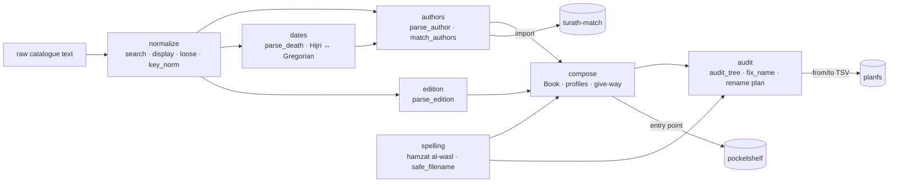

# arabic-bib

**The Arabic bibliographic text layer every library, catalogue and Arabic NLP project ends up rewriting: search
normalisation that keeps the original, book-name composition and audit, author names (ism, nasab, kunya, laqab,
nisba, shuhra) and their matching, «ت 728 هـ» death years, Hijri dates and edition statements. Pure Python, zero
dependencies.**

[](https://github.com/kmbenjel/arabic-bib/actions/workflows/ci.yml)
[](https://pypi.org/project/arabic-bib/)
[](https://pypi.org/project/arabic-bib/)
[](LICENSE)
[](https://warraq.benjelloun.dev/arabic-bib/)


```bash
uvx arabic-bib demo                          # see it work in a second, nothing to install
pipx install arabic-bib                      # or: pip install arabic-bib
arabic-bib audit ~/Books --plan fixes.tsv    # every naming problem, and a rename plan
```

```python
>>> from arabic_bib import match_authors, parse_death, search_key
>>> match_authors("ابن تيمية", "أحمد بن عبد الحليم بن تيمية الحراني").verdict
'same'
>>> match_authors("ابن حجر العسقلاني", "ابن حجر الهيتمي").verdict
'different'
>>> parse_death("المتوفى سنة ثمان وعشرين وسبعمائة").hijri
728
>>> search_key("الإمامُ أبو حامدٍ الغزاليّ")
'الامام ابو حامد الغزالي'
```

## Why arabic-bib? How it compares

General Arabic NLP toolkits normalise letters; none of them knows what a catalogue line is. arabic-bib does the
bibliographic part: it knows that «ابن تيمية» and «أحمد بن عبد الحليم بن تيمية الحراني» are one man and that the two
Ibn Ḥajars are two, it reads «ت بعد 666 هـ» and «الطبعة الثانية، مؤسسة الرسالة، بيروت», and it writes and checks
file names under rules you choose.

Checked on 2026-11-13 by running each library on the same inputs (versions in the header); every cell comes from a
run or from the library's own documentation. Script: [`bench/compare.sh`](bench/compare.sh); full output:
[`bench/RESULTS.md`](bench/RESULTS.md).

| | **arabic-bib 0.1** | PyArabic 0.6.15 | CAMeL Tools 1.6.0 | Maha 0.3.0 | Tashaphyne 0.3.6 |
|---|---|---|---|---|---|
| Search folding of 15 spelling variants (hamza seats, ta marbuta, PDF presentation forms, Persian letters, digits, bidi marks) | **15/15** | 9/15 | 8/15 | 11/15 | 7/15 |
| Folded text mapped back to the original (highlight a hit in the printed string) | ✓ | ✗ | ✗ | ✗ | ✗ |
| Display normalisation (NFC, Arabic punctuation spacing, keeps «هـ») | ✓ | ✗ | partial (Unicode) | partial (spaces) | ✗ |
| Author name parts: ism, nasab, kunya, laqab, nisba, shuhra | ✓ | ✗ | ✗ | ✗ | ✗ |
| Author matching with a same / different / unknown verdict | ✓ | ✗ | ✗ | ✗ | ✗ |
| Death years «ت 728 هـ», «المتوفى سنة ثمان وعشرين وسبعمائة», centuries | ✓ | ✗ | ✗ | ✗ | ✗ |
| Number words «ثمان وعشرين وسبعمائة» → 728 | ✓ | ✓ | ✗ | ✓ | ✗ |
| Ordinals «الحادية عشرة» → 11 | ✓ | ✗ | ✗ | ✓ | ✗ |
| Hijri ↔ Gregorian | ✓ tabular (+ Umm al-Qura via hijridate) | ✗ | ✗ | partial (Hijri day/month in sentences) | ✗ |
| Edition statements → number, publisher, city, years, editors | ✓ | ✗ | ✗ | ✗ | ✗ |
| Book-name composition under a profile; folder audit with a rename plan | ✓ | ✗ | ✗ | ✗ | ✗ |
| Hamzat al-wasl spelling check («الإستغفار» → «الاستغفار») | ✓ | ✗ | ✗ | ✗ | ✗ |
| Morphology, POS, NER, dialect ID, transliteration | ✗ | ✗ | ✓ | ✗ | ✗ |
| Stemming | ✗ | ✗ | ✓ (morphological analyser) | ✗ | ✓ |
| Installed size / dependencies | **1 MB / 0** | 1 MB / 1 | 5639 MB / 81 (PyTorch) | 11 MB / 7 | 6 MB / 2 |

**What the difference buys, measured:**

1. **Author matching: 96 % right, one false merge in 185 labelled pairs.** The quick rules a developer writes on top
   of the other libraries' normalisers reach 26 % («equal after normalising») and 58 % («the words of one are in the
   other»). The pairs are public facts (Ibn Taymiyya, the two Ibn Ḥajars, the Subkīs, the three Ibn al-Athīrs …):
   [`tests/cases/author_pairs.tsv`](tests/cases/author_pairs.tsv).
2. **A form resting only on common parts is `unknown`, never `same`.** «محمد», «شمس الدين», «الدمشقي» or
   «أبو عبد الله» alone never merge two people; the reasons come with the verdict, ready for a review list.
3. **15 of 15 spelling variants meet in one search key**, text copied out of PDFs (presentation forms), Persian
   letters typed for Arabic ones and invisible bidi marks included, while `normalize_mapped` keeps the original:
   search on the key, show the printed string.
4. **Zero dependencies, 1 MB.** It runs in a Pyodide page, a serverless function, Termux on a phone, or next to a
   5 GB NLP stack.
5. **Catalogue keys frozen as «keys v1»** (`title_key`, `author_key`), byte for byte, so ids hashed from them stay
   valid across releases ([`tests/test_keys.py`](tests/test_keys.py)).

**When to use something else.** For morphology, POS tagging, NER, dialect identification or diacritisation, use
[CAMeL Tools](https://github.com/CAMeL-Lab/camel_tools). For stemming, [Tashaphyne](https://github.com/linuxscout/tashaphyne);
for general Arabic string helpers and number spelling, [PyArabic](https://github.com/linuxscout/pyarabic). For
cleaning social-media text and parsing times and durations inside sentences, [Maha](https://github.com/TRoboto/Maha).
For romanised catalogue headings (ALA-LC, the Library of Congress romanisation tables), use your library system:
arabic-bib works in Arabic script. arabic-bib sits next to all of them and takes only the bibliographic part.

## What it reads (input → output, produced by the CLI)

| command | input | output |
|---|---|---|
| `author` | شيخ الإسلام تقي الدين أبو العباس أحمد بن عبد الحليم بن تيمية الحراني (ت 728 هـ) | **ism** أحمد · **kunya** أبو العباس · **nasab** عبد الحليم، تيمية · **laqab** شيخ الإسلام، تقي الدين · **nisba** الحراني · **death** 728 |
| `author` | ابن خلدون، عبد الرحمن بن محمد | **ism** عبد الرحمن · **nasab** محمد · **shuhra** ابن خلدون |
| `match` | ابن تيمية ~ أحمد بن عبد الحليم بن تيمية الحراني | **same** 1.00 (shuhra ابن تيمية) |
| `match` | ابن حجر العسقلاني ~ ابن حجر الهيتمي | **different** 0.10 (nisba conflict) |
| `match` | محمد ~ محمد بن إسماعيل البخاري | **unknown** 0.60 (only common parts) |
| `date` | المتوفى سنة ثمان وعشرين وسبعمائة | **hijri** 728 · **gregorian** 1327–1328 · **century** 8 |
| `date` | الذهبي (673 - 748 هـ) | **hijri** 748 · **birth** 673 · **century** 8 |
| `date` | من علماء القرن الحادي عشر | **century** 11 |
| `hijri` | 728-11-20 | 1328-09-26 (Julian, as historians date it) |
| `edition` | تحقيق: شعيب الأرنؤوط - مؤسسة الرسالة، بيروت، ط 2، 1405هـ/1985م | **number** 2 · **publisher** مؤسسة الرسالة · **city** بيروت · **country** لبنان · **hijri** 1405 · **gregorian** 1985 · **editors** شعيب الأرنؤوط · **role** تحقيق |
| `compose` | تفسير الطبري = جامع البيان عن تأويل آي القرآن · الطبري · تحقيق محمود محمد شاكر، مكتبة ابن تيمية، القاهرة | تفسير الطبري أو جامع البيان عن تأويل آي القرآن - ت محمود محمد شاكر - مكتبة ابن تيمية القاهرة |
| `wasl --fix` | الإجتهاد والإستنباط | الاجتهاد والاستنباط |
| `normalize` | الإِمامُ أبو حامدٍ الغزاليّ | الامام ابو حامد الغزالي |

Regenerate with [`docs/media/make_media.py`](docs/media/make_media.py) (raw output:
[`docs/media/examples.md`](docs/media/examples.md)).

## Features

### Normalisation that keeps the original

```python
from arabic_bib import normalize, normalize_mapped, search_key

search_key("القُرْآن الكريم")                       # 'القران الكريم'
normalize("مكتبــة  المعارف ،الرباط", "display")     # 'مكتبة المعارف، الرباط'
m = normalize_mapped("قالَ الإمامُ أبو حامدٍ الغزاليّ")
[m.original[a:b] for a, b in m.find("ابو حامد")]    # ['أبو حامدٍ']
```

Profiles: `search` (every spelling folds), `display` (NFC, tidy spacing, nothing folded), `loose` (search without
the article), or your own `NormProfile` with each switch on or off.

### Book names: compose and audit

```python
from arabic_bib import Book, compose, explain

compose("الرسالة", "الشافعي", "تحقيق أحمد شاكر، مكتبة الحلبي، القاهرة")
# 'الرسالة - الشافعي - ت أحمد شاكر - مكتبة الحلبي القاهرة'
explain(Book.parse("جمع الجوامع في أصول الفقه ويليه همع الهوامع في شرح جمع الجوامع", "السيوطي",
                   "ت عبد الحميد هنداوي - دار الكتب العلمية"), limit=110)
# Composed(name='جمع الجوامع ويليه همع الهوامع - السيوطي - ت عبد الحميد هنداوي', fits=True,
#          gave_way=('publisher', 'title_tails'), bytes=109)
```

**Nothing is shortened when the name fits.** When it does not, parts give way in the profile's order: the year, the
city, a subtitle, the publisher, editors after the second, other contributors, a long printed role, the second
editor, people's names (to a shorter form of the same name), the words after each title's head, the joined titles,
the first editor; any room left afterwards is given back, the most important part first. A title is cut only at a
natural break, never inside a word, a pair («القضاء والفتيا») or a range («من … إلى …»).

Three profiles ship: **`warraq`** (`<title> - <author> - ت <editor> - <publisher> <city>`, no brackets, commas,
«ط» or «=», 240 bytes with the extension), **`plain`** (only what file systems refuse), **`author-first`**. A profile
is a dataclass: template, byte limit, character rules, give-way order.

```bash
arabic-bib audit ~/Books --profile warraq          # every rule a name breaks, and the fixed name
arabic-bib audit ~/Books --plan fixes.tsv          # from<TAB>to<TAB>reason, deepest paths first
arabic-bib audit ~/Books --format json --strict    # for CI: exit 1 on an error
```

Checks: length in bytes, forbidden characters, spacing, invisible characters, brackets, commas, «=», «ط», hamzat
al-wasl, presentation forms, Persian letters, tatweel, non-NFC names and NFC/NFD twins, raw download names, uploader
words, extensions, one-file folders, a volume number used twice, indexes numbered 99 (`arabic-bib profiles` lists
them).

### Authors

```python
from arabic_bib import match_authors, parse_author

a = parse_author("أبو الفداء إسماعيل بن عمر بن كثير القرشي الدمشقي (ت 774 هـ)")
a.ism, a.kunya, a.nasab, a.nisba, a.death   # ('إسماعيل', 'أبو الفداء', ('عمر', 'كثير'), ('القرشي', 'الدمشقي'), 774)
a.forms()                                    # shorter forms of the same name, longest first

m = match_authors("ابن القيم", "محمد بن أبي بكر بن أيوب ابن قيم الجوزية")
m.verdict, m.score, m.reasons                # ('same', 1.0, ('shuhra:ابن القيم',))
match_authors("الذهبي", "محمد بن أحمد الذهبي", common=["الذهبي"]).verdict   # 'unknown': widen the common list per catalogue
```

Catalogue forms are read as they come: Shamela's «short؛ full», inverted «ابن خلدون، عبد الرحمن بن محمد», quotes,
«المعروف بـ …», particles written without their space («أبوالحسن», «عبدالكريم»). `same_person` and `same_publisher`
compare editors and publishers, with a small table of printing houses known under several names (Būlāq, al-Bābī
al-Ḥalabī, Dāʾirat al-Maʿārif).

### Dates

```python
from arabic_bib import century_label, gregorian_to_hijri, hijri_to_gregorian, parse_death

parse_death("ت بعد 666 هـ")                    # Death(hijri=666, qualifier='after', century=7, …)
parse_death("(ت 1250هـ/1834م)").gregorian      # 1834
hijri_to_gregorian(1400, 1, 1)                 # (1979, 11, 21)
gregorian_to_hijri(1328, 9, 26)                # (728, 11, 20): Julian before 1582, as historians write
century_label(8)                               # 'القرن الثامن الهجري'
```

The tabular (arithmetic) Islamic calendar of reference works, checked against
[convertdate](https://github.com/fitnr/convertdate)'s independent implementation in the test suite. A month began
with the sighting of the moon, so a historical date can differ by a day or two; for 1343–1500 AH pass
`calendar="umalqura"` (install `arabic-bib[umalqura]`).

### Editions, spelling, file names

```python
from arabic_bib import fix_wasl, parse_edition, safe_filename

parse_edition("دار ابن حزم - بيروت - لبنان - ط1 - 2003")   # number=1, publisher='دار ابن حزم', city='بيروت', gregorian=2003
fix_wasl("الإجتهاد والإستنباط")                             # 'الاجتهاد والاستنباط' (pattern IV «إتقان» keeps its hamza)
safe_filename('ديوان المتنبي: شرح "العكبري"?')             # 'ديوان المتنبي شرح «العكبري»؟'
```

## Architecture



Plain functions over strings and frozen dataclasses: no global state, no data files to download.

## Benchmark

[`bench/RESULTS.md`](bench/RESULTS.md), made by [`bench/compare.sh`](bench/compare.sh): one fresh virtual
environment per library, Python 3.12, a Linux VM. The author-pair set was written together with the matcher, so
read 96 % as a regression score on hard public cases; a held-out set from another catalogue is welcome
([CONTRIBUTING](CONTRIBUTING.md)).

## Design decisions

- **Keep the original.** Normalisation never replaces the text you store; `normalize_mapped` gives the offsets back.
- **Three verdicts, with reasons.** A catalogue needs «cannot tell» more than a confident guess: `unknown` is the
  answer whenever only common parts agree.
- **Rules, not a model.** Every decision is a readable rule with a test row: no training data, nothing to download,
  the same answer on every machine.
- **Frozen keys.** `title_key` and `author_key` follow «keys v1» byte for byte; a new key scheme gets a new name.
- **The tabular calendar by default**, documented, with Umm al-Qura as an option: reference works and other software
  use it, and it is reproducible.
- **Profiles over hard-coded rules.** The Warraq library's naming rules ship as the `warraq` profile; yours are
  another `NameProfile`.

## Works with

- [planfs](https://warraq.benjelloun.dev/planfs/): `arabic-bib audit --plan` writes its rename plans;
  `arabic-bib profiles --planfs warraq` prints the naming rules in its profile format.
- [pocketshelf](https://warraq.benjelloun.dev/pocketshelf/) reads book fields from `warraq` names through the
  `pocketshelf.profiles` entry point.
- [turath-match](https://warraq.benjelloun.dev/turath-match/) reconciles catalogues with `search_key`, `title_key`
  and `match_authors`.
- [hijridate](https://github.com/dralshehri/hijridate) for Umm al-Qura dates (optional).

## Roadmap

- Latin-script author forms («Ibn Taymiyya», «al-Ghazālī») matched to Arabic ones, and ALA-LC romanisation.
- A larger, held-out author-pair set from public authority files (VIAF, Wikidata).
- More imprint forms: series statements, volume counts, «مصورة عن طبعة …» chains.
- A browser demo (Pyodide) on the docs site.

## Contributing

The most useful report is the exact string that fails: each one becomes a row in a `tests/cases/*.tsv` table. See
[CONTRIBUTING.md](CONTRIBUTING.md). Arabic documentation:
[warraq.benjelloun.dev/arabic-bib](https://warraq.benjelloun.dev/arabic-bib/) (source in [`docs/ar/`](docs/ar/)).

## Citation and licence

If you use arabic-bib in research, please cite it ([CITATION.cff](CITATION.cff)). Code: MIT. The recordings embed
Kawkab Mono (SIL OFL 1.1, [`docs/media/fonts/OFL.txt`](docs/media/fonts/OFL.txt)).

Part of **[Warraq](https://warraq.benjelloun.dev)** (الورّاق), open tools for digital heritage libraries.
