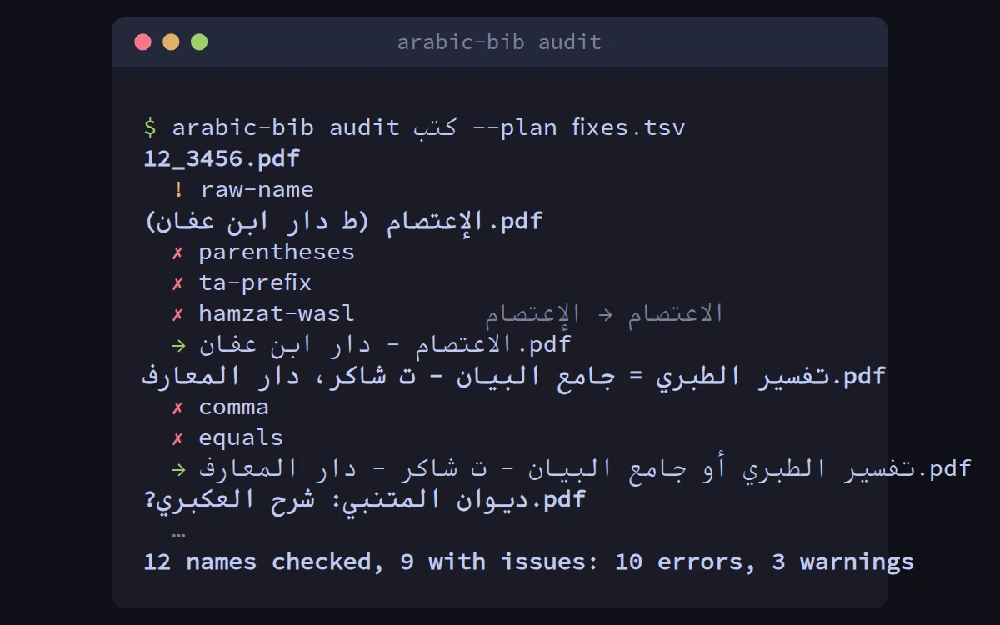

# arabic-bib

**arabic-bib** مكتبة بايثون وأداة سطر أوامر تتولى الجانب الببليوغرافي من النص العربي، وهو الجانب الذي يعيد كتابتَه كلُّ
من يبني فهرسًا لمكتبة أو قاعدة بيانات للتراث أو مشروعًا في معالجة العربية:

- **توحيد الإملاء للبحث** مع الاحتفاظ بالنص الأصلي: «الإمام» و«الامام»، و«مكتبة» و«مكتبه»، والنص المنسوخ من ملفات PDF
  بأشكاله العرضية «ﺟﻬﺎﺩ»، والياء والكاف الفارسيتان، والأرقام الهندية.
- **أسماء المؤلفين**: تفكيك الاسم إلى الاسم العَلَم والنسب والكنية واللقب والنسبة والشهرة، والحكم على صيغتين: هل تدلان
  على رجل واحد؟ فـ«ابن تيمية» هو «أحمد بن عبد الحليم بن تيمية الحراني»، و«ابن حجر العسقلاني» غير «ابن حجر الهيتمي».
- **التواريخ**: «ت 728 هـ»، و«المتوفى سنة ثمان وعشرين وسبعمائة»، و«(673 - 748 هـ)»، و«القرن الثامن الهجري»،
  والتحويل بين التقويمين الهجري والميلادي.
- **بيانات الطبعة**: «الطبعة الأولى، دار الكتب العلمية، بيروت، 1420 هـ - 1999 م» تصير حقولًا: رقم الطبعة والناشر
  والمدينة والسنتين والمحققين.
- **أسماء الملفات**: تركيب اسم الكتاب من عنوانه ومؤلفه ومحققه وناشره وفق قواعد تختارها، وفحص مجلد كامل من الكتب وكشف
  كل مخالفة مع اقتراح الاسم الصحيح، ومنها كتابة همزة القطع على ألف الوصل («الإستغفار»).



## لمن هذه الأداة؟

- **لأمناء المكتبات والمفهرسين**: لتوحيد أسماء المؤلفين ورصد التكرار وتنظيف أسماء الملفات.
- **لطلبة العلم وأصحاب المكتبات الرقمية الشخصية**: لتسمية آلاف ملفات PDF تسمية واحدة مفهومة.
- **للمبرمجين والباحثين**: طبقة جاهزة لمشاريع مطابقة الفهارس (الشاملة، الوقفية، أرشيف الإنترنت) دون أي اعتماديات.

## ابدأ

```bash
pipx install arabic-bib
arabic-bib demo
```

ثم اقرأ [البدء السريع](quickstart.md)، أو [ما الذي يميّزه؟](why.md) لترى مقارنته بالمكتبات الأخرى بالأرقام.

!!! note "من عائلة الورّاق"
    تعمل arabic-bib مع أدوات الورّاق الأخرى: تكتب خطط إعادة التسمية التي ينفذها [planfs](/planfs/)، وتقرأ أسماء
    الكتب لـ[pocketshelf](/pocketshelf/)، وتقوم عليها مطابقة الفهارس في [turath-match](/turath-match/).
